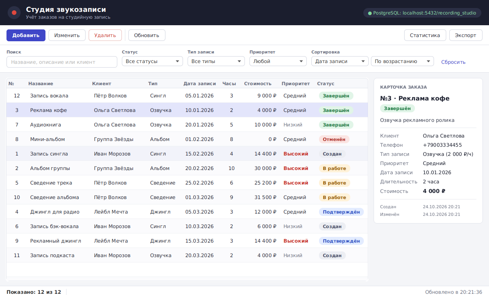

# Студия звукозаписи — JavaFX-клиент (КР №2)

Настольное JavaFX-приложение для учёта заказов на студийную запись.
Продолжение КР №1: та же предметная область, те же сущности и бизнес-правила,
та же база данных PostgreSQL `recording_studio`. Подключение к БД — напрямую через **JDBC**.



**Стек:** Java 21, JavaFX 21 (FXML + CSS), Maven, PostgreSQL, JDBC, slf4j, JUnit 5 + AssertJ.

---

## Статус по частям КР №2

| Часть | Статус |
|---|---|
| Часть 1. Главное окно | ✅ сделано |
| Часть 2. Табличное представление | ✅ сделано: таблица заказов + вкладка «Клиенты» (см. ниже) |
| Часть 3. Добавление / редактирование / удаление | ✅ сделано: модальная форма заказа (см. ниже) |
| Часть 4. Связанные сущности | ✅ сделано: выбор клиента из списка, карточка клиента с его заказами, переходы заказ ↔ клиент (см. ниже) |
| Валидация, диалоги | 🟡 диалоги формы/ошибок/подтверждения готовы; правила проверяет сервис; подсветка неверных полей — дальше |
| Поиск, фильтрация, сортировка | ✅ сделано в главном окне |
| Статистика | ⬜ кнопка есть, окно — дальше |
| Экспорт | ⬜ кнопка есть, экспорт через FileChooser — дальше |

### Что сделано в Части 1

Главное окно (`main-view.fxml` + `MainController`), из которого доступны все функции системы:

- **просмотр списка заказов** — `TableView` с понятными колонками (№, название, клиент, тип, дата, часы, стоимость, приоритет, статус); статус показан цветной плашкой, высокий приоритет выделен;
- **карточка заказа** справа — все сведения о выбранном заказе (описание, клиент и телефон, ставка, стоимость, даты создания/изменения);
- **добавление / редактирование** — кнопки «Добавить», «Изменить» (и двойной щелчок по строке); формы — в Части 3;
- **удаление с подтверждением** — работает полностью: диалог с данными заказа, кнопка «Отмена» по умолчанию, после удаления таблица перезагружается;
- **поиск** — по названию, описанию и имени клиента, срабатывает при вводе;
- **фильтрация** — по статусу, типу записи и приоритету (фильтры комбинируются с поиском);
- **сортировка** — по дате записи, стоимости, названию, клиенту, дате создания; по возрастанию / убыванию;
- **обновление данных** — кнопка «Обновить» заново читает данные из PostgreSQL, выбранная строка сохраняется;
- **переход к статистике** и **экспорт** — кнопки на панели (реализация — в своих разделах);
- **строка состояния** — «Показано: N из M», последнее действие, время обновления;
- **индикатор подключения** к БД в заголовке; если база недоступна — понятное сообщение (без stack trace), а кнопка «Обновить» повторяет попытку.

Кнопки «Изменить» и «Удалить» неактивны, пока в таблице не выбрана строка.

### Что сделано в Части 2

Основные данные предметной области выведены в `TableView` на двух вкладках главного окна
(`TabPane` в `main-view.fxml`):

- **вкладка «Заказы»** — таблица заказов из Части 1 (вместе с панелью действий, фильтрами и карточкой);
- **вкладка «Клиенты»** — новая таблица `clientsTable`: №, ФИО / название, роль, email, телефон
  и **количество заказов** клиента; над таблицей — «Всего: N» и кнопка «Обновить».

Как выполнены требования к таблицам:

| Требование | Как сделано |
|---|---|
| основные поля сущности | заказ — 9 колонок, клиент — 6 колонок |
| выбор строки | `SelectionModel`: выбор заказа обновляет карточку и включает «Изменить»/«Удалить» |
| обновление после добавления / изменения / удаления | после удаления (и после сохранения форм Части 3) вызывается `reloadFromDatabase(id)`: перечитываются **обе** таблицы, нужный заказ выделяется и прокручивается в видимую область (`scrollTo`), счётчики заказов клиентов пересчитываются |
| понятные заголовки | русские заголовки колонок, значения перечислений — русскими названиями |
| нет технических данных | `client_id` заменён именем клиента, `created_at` клиента не показывается, даты/деньги отформатированы |
| `ObservableList` | `visibleOrders` и `clients` подключены через `setItems` — таблица перерисовывается сама после `setAll(...)` |

Сортировка: в таблице заказов — через блок «Сортировка» (сервис, `Comparator`); в таблице клиентов
включена **встроенная сортировка TableView** — щелчок по заголовку колонки (повторный — в обратном порядке),
после обновления данных выбранная сортировка сохраняется (`clientsTable.sort()`).

Количество заказов клиента считает сервис — `RecordingOrderService.countOrdersByClient(...)`
по уже загруженному списку, без лишнего запроса к БД (покрыто тестом).

### Что сделано в Части 3

Полный набор CRUD-операций для заказа через графический интерфейс.

| Операция | Как сделано |
|---|---|
| **Добавление** | кнопка «Добавить» → модальная форма «Новый заказ» (`order-form.fxml`). После сохранения фильтры сбрасываются, таблицы перечитываются из БД, новый заказ выделен в таблице |
| **Редактирование** | кнопка «Изменить» или двойной щелчок по строке → та же форма, заполненная текущими значениями заказа. После сохранения изменённый заказ остаётся выделенным |
| **Удаление** | было в Части 1: подтверждение с данными заказа, «Отмена» по умолчанию |
| **Просмотр** | карточка заказа справа от таблицы (Часть 1) |

Форма заказа:

- поля: название (`TextField`), описание (`TextArea`), клиент, тип записи, приоритет (`ComboBox`),
  дата (`DatePicker`), длительность 1–12 ч (`Spinner`), статус;
- **клиент выбирается из списка** (имя и роль), а не вводится как id;
- **статус**: у нового заказа всегда «Создан»; при редактировании в списке только текущий статус
  и разрешённые переходы (`RecordingOrderService.allowedStatuses`), финальные статусы не меняются;
- **стоимость** показывается сразу и пересчитывается при смене типа, приоритета или часов —
  по той же формуле, что и при сохранении (`RecordingOrderService.calculatePrice`);
- «Сохранить» (Enter) / «Отмена» (Esc); если сервис отклонил данные, показывается сообщение,
  а форма остаётся открытой и введённое не теряется; заказ в таблице до сохранения не меняется.

Изменения в сервисе:

- правило КР №1 «дата записи не может быть в прошлом» теперь проверяется при создании и только при
  **изменении даты** — иначе нельзя было отредактировать ни один прошедший заказ (например, завершить его);
- добавлены `calculatePrice(type, priority, hours)` и `allowedStatuses(status)` для формы;
- тесты `RecordingOrderServiceSaveTest`: создание, расчёт стоимости, дата в прошлом, несуществующий
  клиент, запрещённый переход статуса (репозитории подменены реализациями в памяти, БД не нужна).

### Что сделано в Части 4

Связь из КР №1: `recording_orders.client_id` → `clients.id` (внешний ключ `fk_order_client`).
Приложение учитывает её в обе стороны.

| Требование | Как сделано |
|---|---|
| нельзя вводить id связанной записи вручную | в форме заказа клиент выбирается из `ComboBox<Client>` (имя и роль); в таблице и карточке заказа — имя и телефон клиента вместо `client_id` (`JOIN clients` в репозитории) |
| ссылка на существующую запись | сервис перед сохранением проверяет, что клиент есть в БД (`clientRepository.existsById`) |
| **просмотр связанных данных** | вкладка «Клиенты»: при выборе клиента справа — его **карточка** (роль, email, телефон, «клиент с») и **таблица его заказов** (название, дата, статус, стоимость) с итогом «всего · активных · на сумму» |
| переходы по связи | в карточке заказа — «Карточка клиента и его заказы →» (заказ → клиент); в карточке клиента — двойной щелчок по заказу или «Открыть в заказах» (клиент → заказ) |

Как устроено:

- вкладка «Клиенты» вынесена в отдельный файл `clients-tab.fxml` со своим контроллером
  `ClientsTabController` и подключена в `main-view.fxml` через `<fx:include fx:id="clientsView">`.
  Таблица клиентов из Части 2 переехала туда же — `MainController` стал меньше;
- `MainController` после каждой загрузки передаёт вкладке свежие данные (`clientsViewController.setData(...)`),
  поэтому счётчики и заказы клиента обновляются после добавления, изменения и удаления заказа;
- заказы клиента и итоги считает сервис: `RecordingOrderService.ordersOfClient(...)` (сначала поздние)
  и `summarize(...)` → `ClientOrdersSummary`; отменённые заказы в сумму не входят;
- ячейка статуса вынесена в общий класс `ui/StatusBadgeCell` — она используется в двух таблицах без дублирования;
- тесты `RecordingOrderServiceClientOrdersTest`: выборка заказов клиента, порядок, итоги.

---

## Запуск

### 1. Что нужно

- **Java 21**
- **Maven 3.9+** (или IntelliJ IDEA — Maven встроен)
- **PostgreSQL** с базой из КР №1 (локально или в Docker)

### 2. База данных

**Вариант А — локальный PostgreSQL из КР №1 (по умолчанию).**
Если база `recording_studio` уже создана в КР №1, ничего делать не нужно.
Иначе:

```
psql -U postgres -c "CREATE DATABASE recording_studio;"
psql -U postgres -d recording_studio -f db/schema.sql
```

Параметры подключения — в `src/main/resources/database.properties`
(по умолчанию `localhost:5432`, пользователь `postgres`, пароль `1234`, как в КР №1).

**Вариант Б — база КР №1 в Docker.**

```
docker compose up -d
```

Поднимется PostgreSQL на порту **5433**, при первом запуске выполнится `db/schema.sql`
(таблицы + тестовые данные). В `database.properties` раскомментируйте строку с портом 5433.

### 3. Приложение

| Способ | Команда |
|---|---|
| Maven | `mvn javafx:run` |
| Windows, двойной щелчок | `run.bat` |
| Linux / macOS | `./run.sh` |
| IntelliJ IDEA | открыть папку проекта как Maven-проект → запустить `com.studio.app.Launcher` |

> В IntelliJ запускайте именно `Launcher`, а не `StudioApplication`: проект не модульный,
> и прямой запуск наследника `Application` может выдать «JavaFX runtime components are missing».

Тесты (без БД): `mvn test`.

### Демонстрационная система из архива (Docker)

По методичке её нужно один раз развернуть отдельно (из корня архива с `backend`, `javafx-client`, `android-client`):

```
docker compose --env-file .env -f backend/docker-compose.yml up -d --wait
```

Проверка: `http://localhost:8080/` и `http://localhost:8080/actuator/health`, затем `cd javafx-client` → `mvn javafx:run`.
Наше приложение с ней не связано: оно работает с базой КР №1 через JDBC.

---

## Структура проекта

```
recording-studio-javafx/
├── pom.xml                      Maven: JavaFX 21, PostgreSQL JDBC, slf4j, JUnit (из методички)
├── docker-compose.yml           необязательно: база КР №1 в Docker (порт 5433)
├── db/schema.sql                создание таблиц + тестовые данные (из КР №1)
├── run.bat / run.sh             запуск через Maven
└── src/
    ├── main/java/com/studio/
    │   ├── app/                 StudioApplication (Stage, Scene, загрузка FXML), Launcher
    │   ├── controller/          MainController — главное окно и вкладка «Заказы»,
    │   │                        ClientsTabController — вкладка «Клиенты» (карточка и заказы клиента),
    │   │                        OrderFormController — форма добавления/редактирования заказа
    │   ├── service/             бизнес-логика: RecordingOrderService, ClientService,
    │   │                        OrderQuery (параметры поиска/фильтров/сортировки), OrderSortField,
    │   │                        ClientOrdersSummary (итоги по заказам клиента)
    │   ├── repository/          интерфейсы DAO
    │   │   └── impl/            JDBC-реализации (весь SQL — только здесь)
    │   ├── model/               сущности RecordingOrder, Client и перечисления
    │   ├── config/              DatabaseManager — JDBC-подключение по database.properties
    │   ├── exception/           BusinessException, DatabaseException, EntityNotFoundException
    │   └── ui/                  Dialogs (ошибка/подтверждение), OrderFormWindow (модальное окно формы),
    │                            StatusBadgeCell (ячейка статуса), ChoiceItem, Formatters
    ├── main/resources/
    │   ├── database.properties  параметры подключения к БД (пароль не в коде)
    │   ├── simplelogger.properties
    │   └── com/studio/
    │       ├── view/main-view.fxml   разметка главного окна
    │       ├── view/clients-tab.fxml разметка вкладки «Клиенты» (подключается через fx:include)
    │       ├── view/order-form.fxml  разметка формы заказа
    │       └── css/styles.css        оформление
    └── test/java/…              тесты поиска/фильтров/сортировки, сохранения заказа, заказов клиента
```

### Слои

```
main-view.fxml (View) → MainController → RecordingOrderService → RecordingOrderRepository (JDBC) → PostgreSQL
```

- **FXML** — только разметка: какие элементы, где расположены, `fx:id` и `onAction`.
- **Controller** — реагирует на действия пользователя, собирает параметры, показывает результат. SQL здесь нет.
- **Service** — бизнес-правила (валидация, переходы статусов, расчёт стоимости), поиск/фильтры/сортировка.
- **Repository (DAO)** — SQL через `PreparedStatement`, соединение закрывается через try-with-resources.
- **Database** — ограничения `PRIMARY KEY`, `FOREIGN KEY`, `NOT NULL`, `UNIQUE`, `CHECK`.

### Что изменено по сравнению с КР №1

- Консольный интерфейс (`ConsoleUI`, `InputReader`, `ExceptionHandler`, `Main`) удалён — его заменил JavaFX.
- `DatabaseManager` переехал в `config` и читает `database.properties`; ошибки подключения не роняют приложение.
- Перечисления получили русские названия для интерфейса (`toString()`), в БД по-прежнему хранится `name()`.
- `RecordingOrder` получил поля `clientName` и `clientPhone`; репозиторий заказов читает их через `JOIN clients`.
- В `RecordingOrderService` добавлен `applyQuery(...)` — поиск + фильтры + сортировка для главного окна.
- Правило «дата записи не в прошлом» при редактировании проверяется, только если дату изменили (Часть 3).
- `ExcelExporter` (Apache POI) пока убран: POI нет в `pom.xml` из методички. Экспорт — отдельным разделом.

---

## Как продолжать

**Валидация.** Сервис уже проверяет правила КР №1, форма показывает его сообщения и проверяет,
что выбран клиент. Добавить в `OrderFormController` проверку до сохранения с подсветкой поля
(CSS-класс ошибки): пустые поля, длина названия 3–200, дата не в прошлом — с сообщением, какое поле исправить.

**Статистика.** `statistics-view.fxml` + `StatisticsController`; данные — `orderService.getStatistics()`
(там 7 показателей; заменить `Map.of` на `LinkedHashMap`, чтобы сохранить порядок). Можно добавить `PieChart` по `countByStatus()`.

**Экспорт.** `FileChooser` с фильтром `*.csv` → класс `util/CsvExporter` пишет текущий список
(в контроллере это `visibleOrders`) в UTF-8 с BOM и разделителем `;` — так файл корректно открывается в Excel.
Для `.xlsx` — добавить зависимость `poi-ooxml` и вернуть `ExcelExporter` из КР №1, передавая путь из `FileChooser`.

---

## Подсказки к защите (Часть 1)

- **Stage / Scene / Node.** `Stage` — окно; `Scene` — его содержимое; `Node` — любой элемент
  (кнопка, таблица, панель). В `StudioApplication.start()` создаётся `Scene` из FXML и ставится в `Stage`.
- **FXML ↔ Controller.** `fx:controller` указывает класс; поле с `@FXML` и именем, равным `fx:id`,
  получает созданный элемент; `onAction="#onDelete"` вызывает метод контроллера. `initialize()` вызывается
  после заполнения всех `@FXML`-полей. Контроллер создаётся через `setControllerFactory`, чтобы передать сервис.
- **ObservableList.** `visibleOrders` подключён к таблице через `setItems`; `setAll(...)` меняет список,
  и таблица перерисовывается сама.
- **Поиск / фильтры / сортировка.** Контроллер собирает `OrderQuery` из полей и вызывает
  `orderService.applyQuery(loadedOrders, query)`: поиск по названию/описанию/клиенту, фильтры по статусу,
  типу и приоритету, сортировка `Comparator` по выбранному полю. БД при этом не опрашивается —
  её перечитывает кнопка «Обновить». Сортировка заголовками колонок отключена (`sortable="false"`),
  чтобы был один понятный механизм.
- **Исключения.** DAO оборачивает `SQLException` в `DatabaseException`; контроллер ловит ошибки и показывает
  `Dialogs.showError(...)` с понятным текстом, подробности пишутся в журнал (slf4j).
- **Где пароль БД.** В `database.properties`, не в Java-коде.

## Подсказки к защите (Часть 2)

- **Как TableView получает данные.** `setItems(observableList)` — источник строк;
  `setCellValueFactory` — какое значение объекта показать в колонке; `setCellFactory` — как нарисовать
  ячейку (плашка статуса, цвет приоритета). Таблица создаёт ячейки только для видимых строк.
- **Как таблица обновляется.** После добавления, изменения или удаления вызывается
  `reloadFromDatabase(id)`: сервис читает данные из БД, `visibleOrders.setAll(...)` и `clients.setAll(...)`
  (с Части 4 — в `ClientsTabController.setData`)
  заменяют содержимое списков, `ObservableList` сообщает об этом таблицам — они перерисовываются сами.
  Затем нужная строка выделяется через `getSelectionModel().select(...)` и `scrollTo(...)`.
- **Зачем ObservableList.** Обычный `List` не сообщает об изменениях, и таблицу пришлось бы
  обновлять вручную. `ObservableList` — список со слушателями, на которые подписан `TableView`.
- **Встроенная сортировка TableView** (вкладка «Клиенты»). Щелчок по заголовку добавляет колонку в
  `getSortOrder()`, и таблица сортирует свой список `items` компаратором колонки
  (по умолчанию — естественный порядок значений: числа, строки, enum в порядке объявления).
  В таблице заказов она отключена (`sortable="false"`), там сортирует сервис по выбранному полю.
- **Почему нет технических полей.** Пользователю не нужен `client_id` — вместо него имя клиента
  (репозиторий получает его через `JOIN clients`); дата создания записи клиента в БД не показывается.

## Подсказки к защите (Часть 3)

- **Как открывается форма.** `OrderFormWindow.show(...)` загружает `order-form.fxml` через `FXMLLoader`
  (контроллер получает сервисы через `setControllerFactory`), создаёт новый `Stage` с
  `initOwner(главное окно)` и `initModality(WINDOW_MODAL)` и вызывает `showAndWait()` — метод
  возвращается только после закрытия формы. Затем `MainController` получает сохранённый заказ
  (`Optional`): пусто — пользователь нажал «Отмена».
- **Одна форма — два режима.** `init(null)` — добавление (пустые поля, статус «Создан»);
  `init(order)` — редактирование (поля заполняются значениями заказа, статусы — только разрешённые переходы).
- **Где проверяются данные.** Форма только собирает поля в новый `RecordingOrder`; правила
  (название 3–200, дата, часы, существование клиента, переходы статусов) проверяет `RecordingOrderService`
  и при нарушении бросает `BusinessException`. Форма ловит её, показывает `Dialogs.showError(...)`
  и остаётся открытой. SQL в форме нет — `create`/`update` сервиса вызывают `INSERT`/`UPDATE` в репозитории.
- **Как стоимость считается до сохранения.** Слушатели `valueProperty()` типа, приоритета и часов
  вызывают `orderService.calculatePrice(...)` — ту же формулу, что сервис применяет при сохранении.
- **Обновление таблицы после сохранения.** `reloadFromDatabase(id)` — данные перечитываются из БД,
  сохранённый заказ выделяется (см. Часть 2). Новый заказ виден всегда: перед перезагрузкой фильтры сбрасываются.

## Подсказки к защите (Часть 4)

- **Какая связь в БД.** `recording_orders.client_id` — внешний ключ на `clients.id`
  (`fk_order_client`, `ON DELETE CASCADE`). У клиента может быть много заказов, у заказа — один клиент.
- **Почему клиент выбирается из списка.** Пользователь не знает id; `ComboBox<Client>` показывает имя и роль
  (через `StringConverter`), а в заказ сохраняется `clientBox.getValue().getId()`. Ввести несуществующего
  клиента нельзя, а сервис дополнительно проверяет `existsById` перед сохранением.
- **Как показаны связанные данные.** При выборе клиента `ClientsTabController.showClient(...)` берёт из уже
  загруженных заказов те, у которых `clientId` совпадает (`orderService.ordersOfClient`), кладёт их в
  `ObservableList` таблицы заказов клиента и считает итоги (`orderService.summarize`). Запроса к БД при этом нет.
- **fx:include и вложенный контроллер.** `<fx:include fx:id="clientsView" source="clients-tab.fxml"/>`
  загружает вторую разметку со своим `fx:controller`. FXMLLoader создаёт этот контроллер той же фабрикой
  (`setControllerFactory` в `StudioApplication`) и внедряет его в поле `clientsViewController` главного
  контроллера (правило: `fx:id` + `Controller`). Так главное окно передаёт вкладке данные и получает от неё
  действия («Обновить», «Открыть заказ») через `setActions(...)`.
- **Переход между вкладками.** `mainTabs.getSelectionModel().select(tab)` переключает вкладку, затем нужная
  строка выделяется (`getSelectionModel().select(...)`) и прокручивается в видимую область (`scrollTo`).
